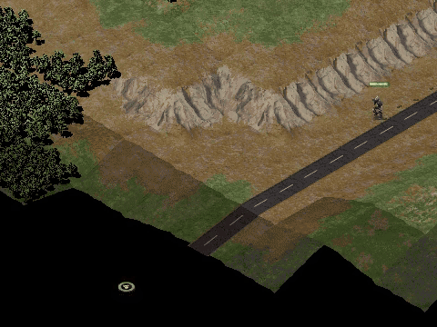
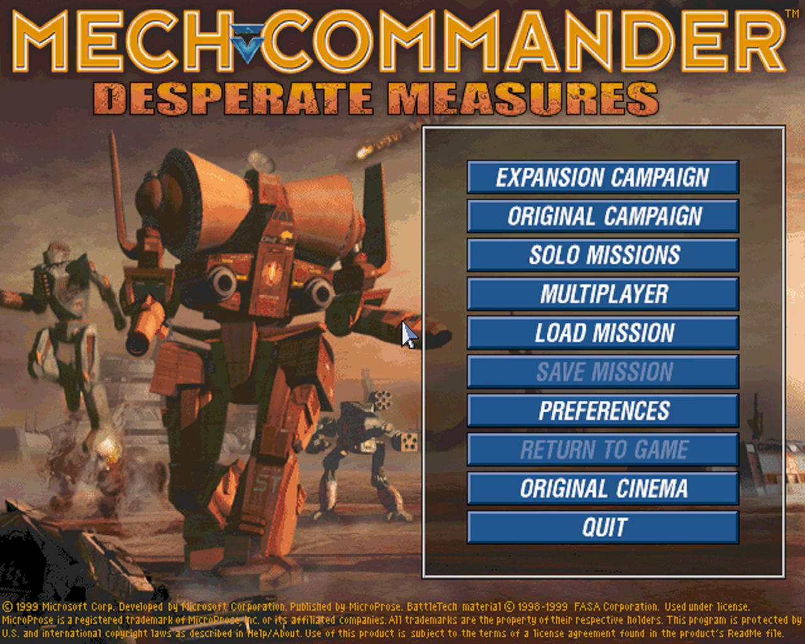
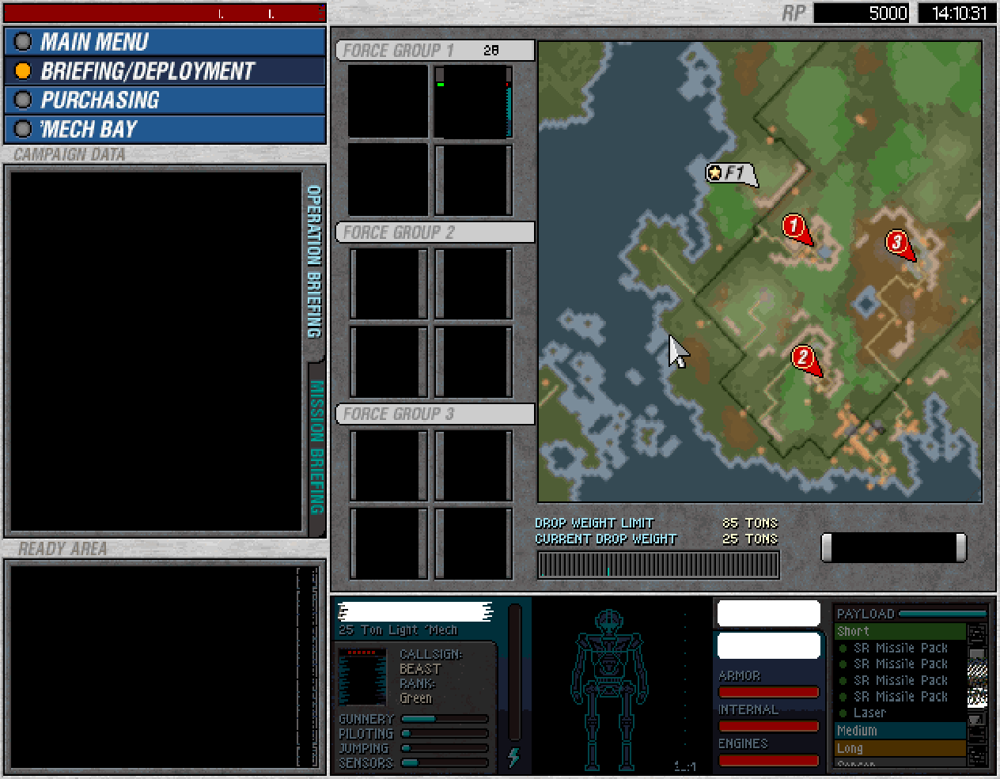
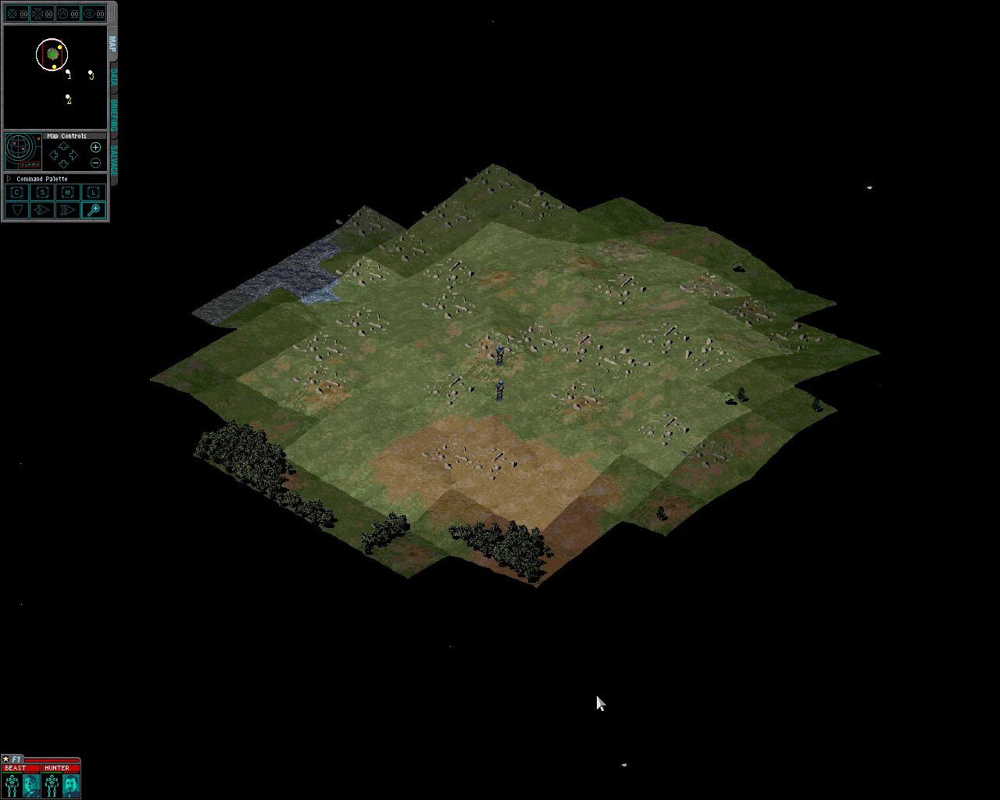
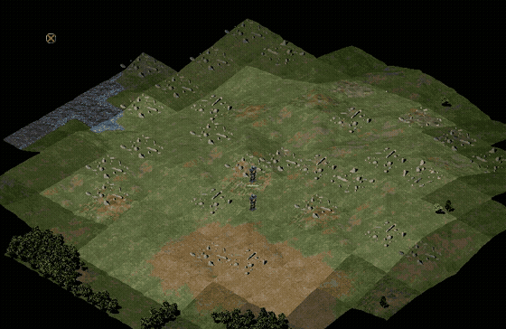
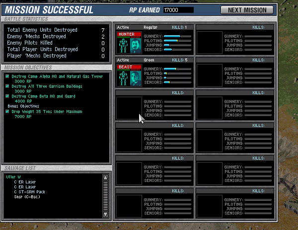

# MechCommander Gold — Static Recompilation



Static recompilation of **MechCommander Gold** / *Desperate Measures*
(1998–99, FASA Interactive / MicroProse), from its shipping `MCX.EXE` to C
that builds and runs natively on Windows 10/11.

Built on the [pcrecomp](https://github.com/sp00nznet/pcrecomp) toolchain and
following its shared house style (layout, CLI, conformance harness, headless
mode).

## Status: **v0.1.0, alpha. Boots, plays the menus, and plays the first campaign mission start to finish: every objective destroyed, "MISSION SUCCESSFUL", the debriefing with its salvage. Recompiled throughout.**

| Stage | State |
|---|---|
| P0: identify the binary | done: `MCX.EXE`, MSVC 6, image base `0x00600000`, no packer or DRM. It ships its **CodeView debug info**: 12,614 public symbols with C++ names, 612 modules, FPO records |
| Function table (`tools/cv_extract.py`) | 5,760 functions read from the debug info, 98.7% of `.text`; 5,113 with a full C++ signature |
| Lift (`run_pipeline.py`) | **whole program**: 6,065 functions (the debug info's 5,760 plus what four discovery passes find), 0 lift errors, 1.56M lines of C |
| Imports (`gen_imports.py`) | all 204 bridged, argument counts derived from three sources and cross-checked; 307 `imagehlp` exports resolved at run time |
| Host (`build/mcg_recomp.exe`, x64) | maps the image at its own addresses; Win32 forwarded to the host, DirectDraw/DirectSound/DirectPlay mocked as COM objects in simulated memory |
| Graphics | the engine's own software renderer, 8bpp shell and 16bpp mission, presented into a framed or borderless-fullscreen window, aspect kept, paced to the display from its own thread; `--res` up to 3840x2160 for a wider battlefield |
| Intro, main menu, campaign shell | **run**: New Campaign, briefing, deployment (drag 'Mechs into force groups), launch |
| Mission | **runs**: terrain, water, forest, units, HUD, radar. **Plays through**: selection, move and attack orders, combat, objectives, and the end of the mission with its debriefing. The next mission not yet tried |
| Sound | **plays**: the engine's DirectSound buffers are mixed on the host (waveOut), with volume, pan and real-time cursors. `MCG_VOLUME=0..100`, `MCG_MUTE=1`; headless runs stay silent, `MCG_WAVDUMP=file.wav` records the mix |
| Movies | **play**: own Smacker decoder (video, 8/16bpp, and DPCM audio into the host mix), paced to the movie clock |
| Headless mode | `--headless --record out.mp4`, with `--click` for scripted input. Never shows or activates a window |
| Conformance harness | **15/15** milestones (boot to a mission, a move order and a kill, headless), **31/31** self-tests, 0 lift errors; with `--playthrough`, **7/7** more for mission 1 played to the debriefing and on to the next mission's shell (~18 min) ([tools/conformance.py](tools/conformance.py)) |

## Screenshots

Real output of `build\mcg_recomp.exe`, recompiled code throughout:

| | |
|---|---|
|  |  |
|  |  |
|  | |

## What is not in this repo

Nothing from the game: no executable, no data, no disc image, and **no
generated source or symbol maps**. The function table, the recompiled C and
the import bridges are produced on your machine from your own copy, into
`work/`, `src/recomp/gen/` and `src/runtime/imports_gen.c`, which are
gitignored. The tool ships; its output never does.

## Getting Started

You need **your own copy of MechCommander Gold**: the CD, an ISO of it, a zip
of it, or an installed game folder (anything with `MCX.EXE` in it). Nothing is
downloaded for you.

### Quick start: the installer

Download `MechCommander-Gold-Recomp-Installer-windows-x64.exe` from the
[latest release](https://github.com/sp00nznet/mcg-recomp/releases/latest) and
run it. It looks for your copy of the game (or **Choose folder…**), then
**Build** downloads this repository and pcrecomp and runs `Setup.cmd` below for
you, and **Play** starts the game. It is unsigned, so Windows SmartScreen asks
first (**More info**, **Run anyway**). It is
[recomp-launcher](https://github.com/sp00nznet/recomp-launcher) with this
repo's `launcher/launcher.json`; nothing of the game is in it.

### Quick start: Setup.cmd

1. Download this repository (the green **Code** button, then **Download ZIP**)
   and unzip it somewhere with 2 GB free.
2. Double-click **`Setup.cmd`**.

It checks for Python 3.10+, the `pefile` and `capstone` packages, the pcrecomp
toolkit and the Visual Studio 2022 C++ compiler, and **asks** before
installing any of them, saying what and how big. It finds the game on your
drives (or in `Program Files\MicroProse`), or asks where it is (a drive, a
folder, or a `.iso`/`.zip`). Then it copies the game into `game\`, reads the
function table, recompiles `MCX.EXE` and builds `build\mcg_recomp.exe`. A
rerun skips the finished steps. If it stops, it says why in one sentence, and
the details are in `setup.log`.

It ends with a **`MechCommander Gold`** shortcut in the folder. Double-click it
to play.

### Step by step

Prerequisites: Windows 10/11, **Python 3.10+** (`py -3 --version`), **git**,
**Visual Studio 2022** (or its Build Tools) with *Desktop development with
C++* (that brings CMake, Ninja and the Windows SDK), **ffmpeg** on `PATH` for
`--record` only, and the pcrecomp toolkit cloned **beside** this repository as
`tools`:

```
some-folder\
  tools\                        <- git clone https://github.com/sp00nznet/pcrecomp tools
  mcg\                          <- this repository
```

1. Python packages:
   ```
   py -3 -m pip install --user pefile capstone
   ```
2. Your copy of the game into `game\` (from the CD, a mounted ISO, or a folder):
   ```
   robocopy E:\ game /E
   attrib -R game\* /S
   ```
   `game\MCX.EXE` must exist afterwards.
3. The function table, out of `MCX.EXE`'s own debug info:
   ```
   py -3 tools\cv_extract.py
   ```
   Expected, at the end:
   ```
     5,760 functions, 5,113 with C++ signatures, 2,038 with an exact size
     1,521,059 of 1,541,288 .text bytes covered (98.7%)
   ```
4. Recompile to C:
   ```
   py -3 run_pipeline.py
   ```
   Expected:
   ```
   [*] 6066 functions: 5760 CodeView publics, +94 FPO-only, +54 from data pointer tables, +158 via the call graph
   ============================================================
     functions: 6,065   lift errors: 0   files: 13
   ```
5. The import bridges:
   ```
   py -3 gen_imports.py
   ```
   Expected, at the end: `argc derived from: binary+import+sdk x10, binary+sdk x193, sdk x1`.
6. Build (MSVC x64, CMake and Ninja; all three come with the C++ workload):
   ```
   build.cmd
   ```
   Expected: `Linking C executable mcg_recomp.exe`.
7. Check it without opening a window:
   ```
   build\mcg_recomp.exe
   ```
   Expected: `[runtime] 6065 lifted functions, 204 import bridges` and
   `(dry run: image mapped and bound; --run enters 0x00762C24)`.
8. Play: `build\mcg_recomp.exe --run`.

The usual trip-ups: `python` opening the Microsoft Store (that is Windows' alias
placeholder; use `py -3`, or turn the alias off in *Settings > Apps > Advanced
app settings > App execution aliases*); a freshly installed Python not being on
`PATH` until you open a new window; and files copied off a CD staying
read-only, which stops the game writing its settings (`attrib -R` above).

## Usage

```
build\mcg_recomp.exe --run                                    # play
build\mcg_recomp.exe --run --headless --record out.mp4 --watchdog 120
build\mcg_recomp.exe --run --headless --watchdog 170 --click "477,165@8;477,165@18;477,165@28;37,376>248,61@45;37,376>304,61@55;37,376>246,172@65;570,339@78;570,339@90"
build\mcg_recomp.exe --selftest                               # lifted CRT and blitters vs the host
py -3 tools\conformance.py                                    # milestones, self-test and lift health, vs the baseline
```

The third line plays New Campaign, deploys the lance and launches the first
mission with nobody at the keyboard; add `;15,1005@115;820,430@122` and the
first 'Mech is selected and walks to open ground.

| Flag | |
|---|---|
| `--run` | enter the game (without it: map, bind and stop) |
| `--game DIR` | the game folder, holding `MCX.EXE` (default `game`) |
| `--headless` | a cloaked window that never reaches a screen or takes focus; the real keyboard and mouse are ignored |
| `--record out.mp4` | pipe what the window shows to ffmpeg (the window's client size, 30 fps, wall-clock paced) |
| `--fullscreen` | borderless window over the whole monitor, no mode switch; `--window` (default) is a framed window |
| `--scale sharp\|smooth\|integer` | how the picture fills the window, aspect always kept (pillar/letterbox bars): nearest-neighbour (default), filtered, or whole multiples only |
| `--res WxH` | the resolution the game runs at, up to 3840x2160 (default: `PREFS.CFG`'s, 1280x1024). A wider one shows more of the battlefield; see [docs/hires.md](docs/hires.md) |
| `--fps` | engine and display frame rates in the corner, and on stderr once a second |
| `--frames N` | exit after N presented frames |
| `--watchdog S` | every 3 s, say where the engine is; stop after S seconds |
| `--click SPEC` | scripted mouse: `x,y@t` clicks and `x,y>x2,y2@t` drags in the 640x480 shell's coordinates (the mission's 1280x1024 once it runs), and `:text@t` to type, `t` in seconds from the campaign shell appearing |
| `--selftest` | check the lifted CRT string routines, number parser, float printing and blitters against the host |

Settings live in `build\mcg.ini`, written with defaults on the first run:
key remapping (`[keys] Q=A`), `[game] unlock_missions=1` (the developers' own
mission jump: type a mission's two-digit number on the briefing screen), and
the display and sound keys the flags also set. A flag beats the file. See
[docs/settings.md](docs/settings.md).

Bring-up switches (environment): `MCG_WATCH=0xADDR` names the call that changes
a dword, `MCG_CURSOR=x,y` pins the pointer, `MCG_NOSCALE=1` shows the raw
display mode. All of them, and what each was for, are in
[docs/bringup.md](docs/bringup.md).

## Building from source

Steps 3 to 6 above. `PCRECOMP` (Python) and `-DPCRECOMP=` (CMake, through
`set CMAKE_ARGS=...` for `build.cmd`) point at a toolkit checkout other than
`..\tools`; the lifter and the runtime must come from the same tree
([docs/toolkit.md](docs/toolkit.md)). The bring-up trace build is
`set BUILD_DIR=build-trace & set CMAKE_ARGS=-DCMAKE_C_FLAGS=-DRECOMP_TRACE & build.cmd`.

On a [recomp-netlab](https://github.com/sp00nznet/recomp-netlab) farm,
`netlab build mcg` builds the same tree with clang-cl in about three minutes
(the recipe sends the generated C, never `game/` or `work/`), and
`netlab qa mcg` runs the conformance harness against it.

How the pieces fit is [docs/architecture.md](docs/architecture.md); what it
took to get this far, and what was ruled out, is
[docs/bringup.md](docs/bringup.md); what is next is [ROADMAP.md](ROADMAP.md).

[mcgoldng](https://github.com/sp00nznet/mcgoldng) is the clean-room
reimplementation of the same game; its asset decoders (FST, PAK, LZ, FIT, VFX
shapes, palettes) are the other approach to the same problem.

## License

MIT, for the code in this repository ([LICENSE](LICENSE); what it does not
cover is in [NOTICE](NOTICE)). MechCommander Gold itself is © 1998–1999 FASA
Interactive / MicroProse; none of it is here.
