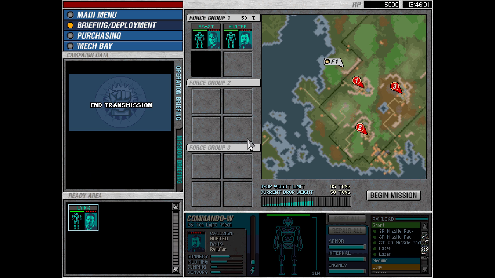
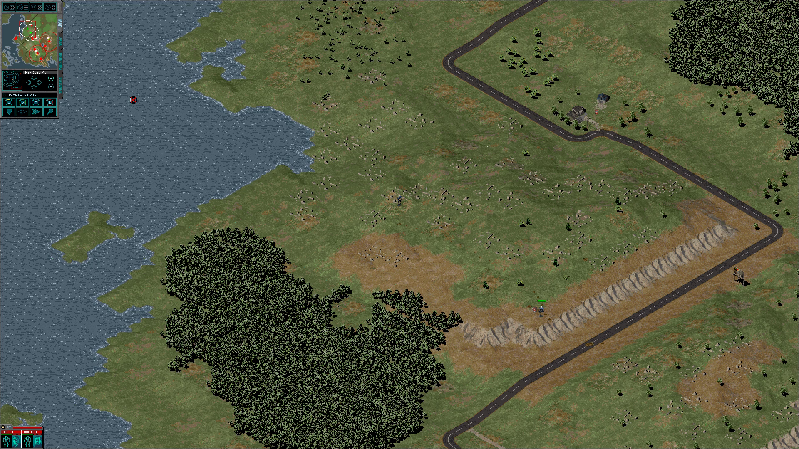

# High resolution, fullscreen and presentation

| | |
|---|---|
|  |  |

    mcg_recomp --run --fullscreen --res 1920x1080

The remaster pass: how the picture reaches the screen, and how the battlefield
gets wider. All of it is host-side or a config value -- no engine code is
patched.

## Presenting (src/runtime/display.c)

- **Aspect is always kept.** The picture (`g_shown_w x g_shown_h`: the
  640x480 shell layout or the full mode in a mission, chosen by present()'s
  probe) is fitted inside the client area with black bars. `--scale sharp`
  (default) is nearest-neighbour (`COLORONCOLOR`), `smooth` is GDI `HALFTONE`,
  `integer` uses whole multiples only when one fits.
- **Mouse mapping goes through the same rectangle.** `display_unmap()` inverts
  `display_rect()`; a pointer on a bar counts as outside the window and the
  last inside position is held (see ddraw_map_cursor for why holding, not
  clamping).
- **`--fullscreen`** is a borderless `WS_POPUP` over the primary monitor. No
  display-mode change. The engine's own `SetWindowPos` to the mode size is
  ignored for the game window while fullscreen.
- **Paced to the display from a second thread.** present() still converts the
  engine's back buffer on the main thread (it has to: the buffer is redrawn
  right after the flip), into one of three host DIBs. A present thread blits
  the newest one and waits in `DwmFlush()`, i.e. one blit per compositor
  frame; frames that arrive faster are coalesced, never queued. DWM
  composites every window, so a windowed GDI blit cannot tear. The thread
  only touches host GDI objects -- never simulated memory or the lifted CPU
  state -- so lifted code stays single-threaded and the 50 ms heartbeat
  timer is untouched. `--fps` shows engine vs display rates and the worst
  gap between engine frames.
- **`--record`** now records the window composition (client size, bars and
  scaling included) instead of a fixed 1280x1024 stretch.

## Widescreen battlefield (`--res WxH`)

What controls the size, found from the CodeView names:

1. `_systemInit` (0x007590D0) reads `Resolution` (1/2/3) from `PREFS.CFG` and
   sets `displayMode` (0x007AB1D8) plus `displayWidth`/`displayHeight`
   (0x007A9E70 / 0x007AA920): 800x600, 1024x768, 1280x1024.
2. `aSystem::start` (0x00612C10) reads those two globals straight back and
   passes them to `startupDirectDraw` / `resetDirectDraw`, which store
   `gWidth`/`gHeight` (0x00789F70/74) and set the display mode. The tactical
   viewport, camera projection and HUD all size from there; the HUD panels
   are anchored to the screen corners already.
3. Each mission's terrain FIT has `VisibleVerticesPerSide`, read by
   `Terrain::init` through `FitIniFile::readIdLong` (0x0064A190) into
   `Terrain::visibleVerticesPerSide` (0x00809F20). It is the side of the
   square of map vertices around the camera that is cached and drawn; it is
   sized for 1280x1024. At 1920x1080 without a change, the screen corners look
   past it at uncached vertices, which draw as noise.

`--res` therefore overrides (both via `OVERRIDES` in run_pipeline.py and
`recomp_lookup_manual`): `_systemInit` is wrapped to replace
`displayWidth/displayHeight` after it runs, and `readIdLong` is wrapped to
scale `VisibleVerticesPerSide` by `max(W/1280, H/1024)` (rounded up to even)
when it is the value being read. `displayMode` stays as PREFS.CFG set it
(3 = the 1280x1024 art set).

## Not a viewport bug: the black around the drop zone

At any resolution a fresh mission shows the terrain as an island around the
lance with black all round. That is the fog of war -- terrain nobody has seen
is not drawn, and the minimap shows the same small circle. With the
developers' reveal cheat (`mineeyeshaveseentheglory`, docs/bringup.md) the
terrain fills the whole view at 1280x1024 and at 1920x1080.

## Known limits

- Mission load takes longer at a wider `--res`: the terrain cache grows with
  the square of `VisibleVerticesPerSide` (30 -> 46 at 1920x1080), and loading
  mission 1 took well over a minute (headless, unprofiled) where 1280x1024
  is quick.
  The frame rate in play was about 30 fps at 1920x1080, headless.
- Without the `VisibleVerticesPerSide` change, 1920x1080 drew noise in the
  screen corners and once stalled the engine for good ~20 s after an order,
  which is consistent with reading past the vertex cache. Do not drop it.
- `--click` coordinates in a mission are in the `--res` space; the shell is
  always the 640x480 layout.
- The `--fps` text is drawn on the window, after the recording takes its
  copy, so it is not in a `--record` video; stderr carries the same numbers.
- `displayMode` stays 3 (1280x1024 art). Below 1280x1024 the HUD art is
  still the large set; pick PREFS.CFG's Resolution for those instead.
